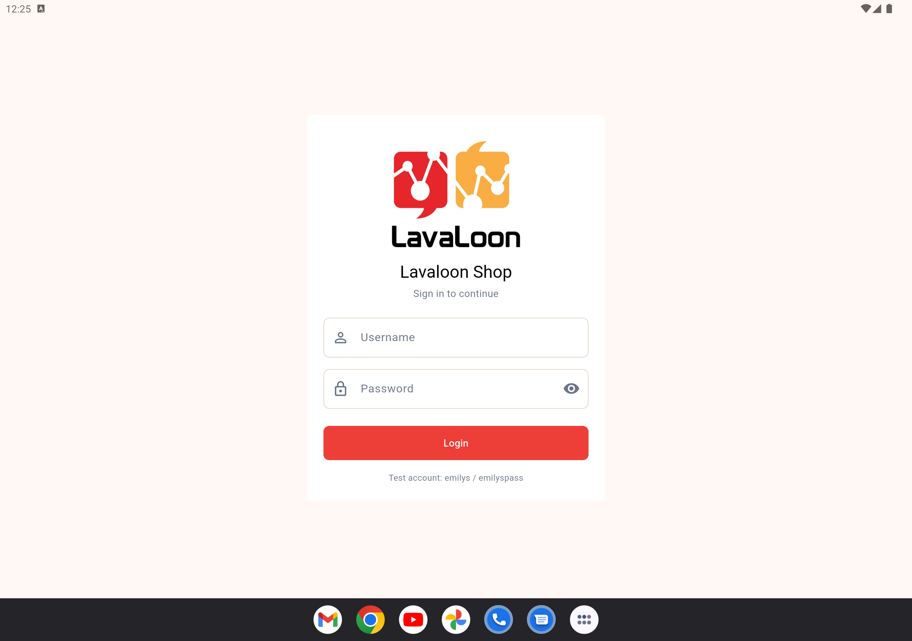
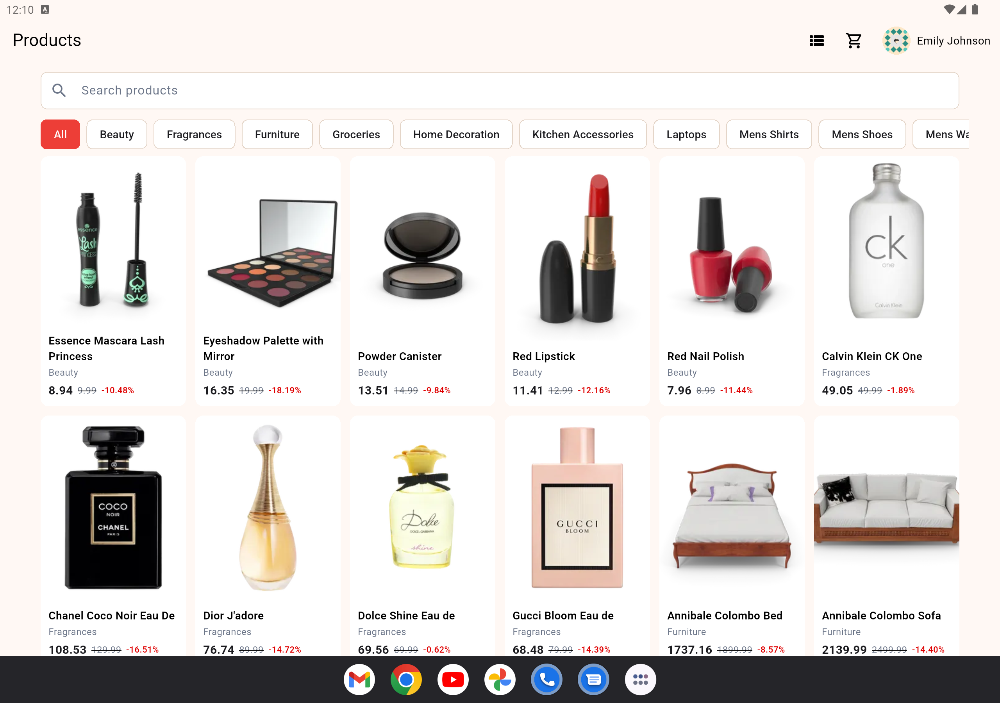
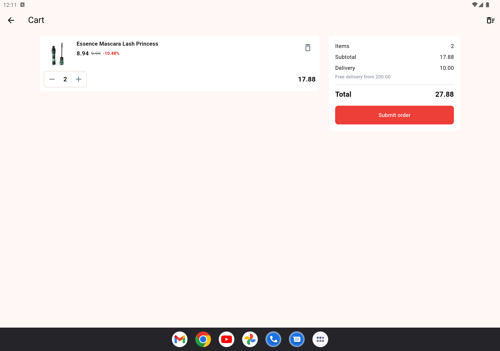
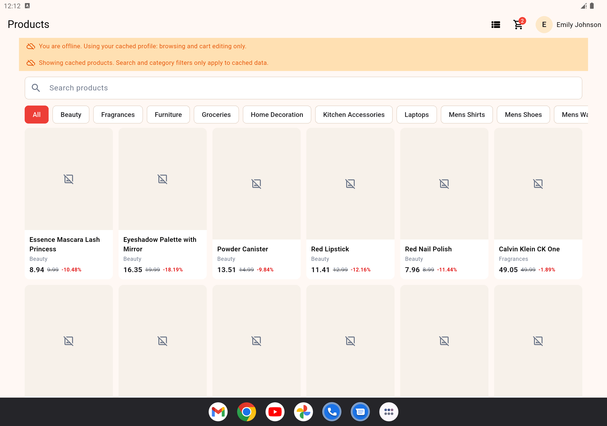

# Lavaloon Shop

I used an AI assistant on this project for repetitive files, this README, autocomplete, and for looking up errors while I was stuck. The structure of the code comes from shopping and POS apps I have built and maintained before, which is why I could move faster. I reviewed what went in, and the result is mine.

A small shopping app for the Lavaloon Flutter assessment. It signs in against DummyJSON, browses products, and keeps a cart on the device for each user. Placing an order sends that cart to `POST /carts/add`.

## Setup

Flutter SDK that satisfies `pubspec.yaml` (Dart 3.10 or newer), plus an Android emulator or a device.

```bash
flutter pub get
flutter run
```

## Test account

Username `emilys`, password `emilyspass`.

DummyJSON also accepts its other sample users, such as `michaelw` / `michaelwpass`. Each user has a separate cart.

## Architecture

The UI does not call DummyJSON or SQLite. A screen talks to a cubit, the cubit calls one use case, and the use case talks to a repository or to the API client.

- `lib/presentation` holds the screens, widgets, routes, theme, and cubits (`AuthCubit`, `CatalogCubit`, `CartCubit`, `ProductDetailsCubit`).
- `lib/business_layer` holds the rules. Use cases are one action each. Repository interfaces live here, next to `CartCalculator` and `CartValidator`. Entities are the plain domain objects.
- `lib/data` holds the JSON models, the mappers between models and entities, and the error types.
- `lib/data_access` does the I/O. `DummyJsonIntegrator` is the Dio client. `AppDatabase` is SQLite. `SessionStorage` is the secure token store. The repository implementations are here.

`get_it` wires this in `lib/injector.dart`.

## Storage

- The access token and its expiry are in `flutter_secure_storage`. The password is never stored.
- The cached user and the list/grid choice are in `shared_preferences`.
- Products, categories, and cart lines are in SQLite (`sqflite`). Cart rows are keyed by user id and product id, so signing in as someone else does not show the previous cart.

## Cart rules

The discounted unit price is rounded to two decimals, then multiplied by the quantity. Delivery is 10 while the subtotal is under 200, and free from 200 up. An empty cart has no delivery fee. Adding a product that is already in the cart increases that line. The quantity cannot pass the stock. Submit clears the cart only after `POST /carts/add` succeeds. A failure leaves the cart as it was.

## Offline

If the network is down at launch and the token is still valid, the cached profile is restored and the catalog and cart stay usable. The screen says so. Search and category filters then apply only to what is already cached. Product photos that cannot be loaded use a placeholder. Submit needs the network. If it fails, the cart stays.

If the saved token is expired, or DummyJSON rejects it, the session is cleared and the login screen is shown.

## Assumptions

- DummyJSON is the only backend. Login is `POST /auth/login`, the current user is `GET /auth/me`, and the order is `POST /carts/add`.
- The session expiry is read from the access token.

## Tests

The tests use in-memory fakes. They do not call DummyJSON and do not need a device.

```bash
flutter test
```

One file, or one test by name:

```bash
flutter test test/cart_calculator_test.dart
flutter test --name "delivery is free"
```

## Screenshots

The login screen, with the test account under the button.



Signed in as Emily.



Cart with the quantity, the discount, and the delivery fee.



Offline. The cached profile and the cached products stay on screen, and the cart is still there.



## Time

About 9 to 10 hours. I did this after work, in a rush.

## Incomplete requirements

I built the behavior the brief asks for. Because it was done in a hurry after work, I may have missed something small. I did not leave a required flow unimplemented on purpose.
